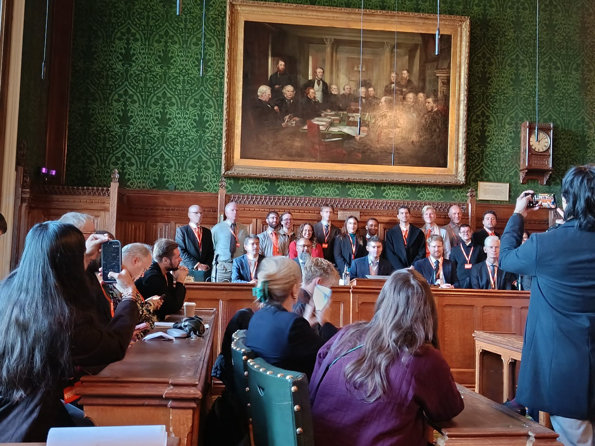

Na otázku, [prečo pauzu žiadame](/otazky/#preco-pauza), odpovedáme inde. Tento článok je
o tom, ako sa k nej dá dostať. Vychádzame z [návrhu hnutia PauseAI](https://pauseai.info/proposal)
a z jeho [teórie zmeny](https://pauseai.info/theory-of-change) a pri každom kroku píšeme aj to,
čo zatiaľ vyriešené nie je.

## Čo presne žiadame

Dočasne pozastaviť tréning najvýkonnejších všeobecných systémov AI, kým nebudeme vedieť, ako
ich vytvárať bezpečne a udržať pod demokratickou kontrolou.

Tri veci sú na tej vete dôležité:

- **Týka sa tréningu nových, ešte výkonnejších modelov.** Nástroje, ktoré dnes používaš,
  zostávajú. Úzko zamerané systémy, napríklad na čítanie röntgenových snímok, sa môžu vyvíjať
  ďalej.
- **Musí platiť pre všetkých naraz.** Firma ani štát nespomalí sám, lebo by prenechal náskok
  konkurencii. Preto hovoríme o medzinárodnej zmluve, nie o slovenskom či európskom zákaze.
- **Končí sa splnením podmienky, nie dátumom.** Ak sa bezpečnosť podarí preukázať rýchlo,
  pauza bude krátka.

## Čo by v dohode bolo

### Medzinárodná agentúra

Návrh počíta s agentúrou podľa vzoru Medzinárodnej agentúry pre atómovú energiu, ktorá od roku
1957 kontroluje jadrový materiál. Agentúra pre AI by povoľovala veľké tréningy a nasadenia,
určovala podmienky dohľadu a overovala, či ich štáty a firmy dodržiavajú.

### Kontrola cez čipy

Tréning špičkového modelu vyžaduje desaťtisíce špecializovaných čipov a dátové centrum so
spotrebou menšieho mesta. Dodávateľský reťazec je mimoriadne úzky: stroje na výrobu
najpokročilejších čipov vyrába jediná firma na svete, holandská ASML, a samotné čipy vyrába
prevažne taiwanská TSMC podľa návrhov niekoľkých firiem na čele s Nvidiou
([Computing Power and the Governance of AI](https://arxiv.org/abs/2402.08797)).

Vďaka tomu sa dá sledovať, kde čipy sú a na čo sa používajú. Navrhované metódy siahajú od
evidencie čipov a inšpekcií dátových centier cez sledovanie spotreby energie po ochranu
oznamovateľov
([Shavit, 2023](https://arxiv.org/abs/2303.11341);
[Wasil a kol., 2024](https://arxiv.org/abs/2408.16074)).

### Podmienky na pokračovanie

Výkonnejšie systémy by sa mohli trénovať až vtedy, keď agentúra uzná, že existujú overiteľné
spôsoby, ako ich udržať pod kontrolou. Návrh PauseAI ide ďalej: o nasadení systému schopnejšieho
než ľudia by nemala rozhodovať jedna firma ani jedna vláda a dostatočne veľká skupina štátov by
ho mohla vetovať. Úžitok z takých systémov sa má deliť, aby dohoda bola výhodná aj pre krajiny,
ktoré ich samy nevyvíjajú.

## Prečo to nie je utópia

Štáty sa na obmedzení nebezpečnej technológie dohodli viackrát, aj keď to niekoho stálo
peniaze:

- **Ozónová vrstva.** K Montrealskému protokolu z roku 1987 pristúpili všetky štáty sveta
  a 99 % látok, ktoré protokol obmedzuje, sa už prestalo používať
  ([UNEP](https://ozone.unep.org/ozone-and-you)).
- **Biologické a chemické zbrane.** Zakazujú ich dohovory z rokov 1972 a 1993, ku ktorým
  pristúpila veľká väčšina štátov.
- **Jadrové zbrane.** Zmluva o nešírení a inšpekcie agentúry pre atómovú energiu nezabránili
  všetkému, ale jadrových mocností je dnes deväť, nie desiatky, ako sa v 60. rokoch čakalo.
- **Klonovanie ľudí.** Technicky je pravdepodobne možné, desiatky štátov ho zakázali a nie je
  známy žiadny overený prípad.

Ani jedna z týchto dohôd nie je dokonalá a žiadna nevznikla za rok. Ukazujú však, že veta
„technológiu nemožno zastaviť“ neplatí vždy.

Pri AI už prvé kroky prebehli. Od roku 2023 sa konali štyri medzinárodné samity o AI
a [deklaráciu z Bletchley](https://www.gov.uk/government/publications/ai-safety-summit-2023-the-bletchley-declaration),
ktorá uznáva riziká najvyspelejších systémov, podpísali Spojené štáty, Čína aj Európska únia.
Nič právne záväzné z nich zatiaľ nevzišlo.

## Ako sa k dohode dostať

Hnutie PauseAI otvorene píše, že pauzu samo nezariadi. Podľa jeho teórie zmeny potrebuje
medzinárodná dohoda päť vecí:

1. politickú vôľu vo viacerých veľmociach,
2. technický a právny rámec, ktorý sa dá podpísať,
3. vhodný okamih, najskôr po udalosti, ktorá riziko ukáže verejnosti,
4. zhodu odborníkov a politických elít,
5. verejnú podporu, vďaka ktorej sa politikom podpis oplatí.

Rámec a odbornú zhodu pripravujú výskumné a politické organizácie. Úloha hnutia je zvyšok:
premeniť obavy, ktoré ľudia už majú, na viditeľný a organizovaný hlas. Robí to cez národné
skupiny, ktoré sa stretávajú, píšu svojim poslancom, organizujú pokojné zhromaždenia
a koordinujú sa navzájom, aby tá istá požiadavka zaznela vo viacerých krajinách naraz.

Hnutie má aj hranice, ktoré si určilo samo: žiadne násilie, žiadne postoje k témam mimo pauzy
a poctivosť v tom, čo nevieme.

## V parlamentoch sa o tom už hovorí

- **Praha, 11. novembra 2026.** PauseAI Česko usporiadalo v Poslaneckej snemovni okrúhly stôl
  o vplyve AI na trh práce a spoločnosť. Zúčastnili sa na ňom českí aj zahraniční odborníci,
  poslanci a riaditeľ PauseAI Global Maxime Fournes
  ([PauseAI Česko](https://pauseai.cz/nase-cinnost)).
- **Londýn, august 2025.** PauseAI UK zverejnilo list, ktorý podpísalo 60 britských poslancov
  a členov Snemovne lordov naprieč stranami. Vyčítajú v ňom firme Google DeepMind, že model
  Gemini 2.5 Pro vydala bez sľúbených informácií o bezpečnostnom testovaní. Google odpovedal,
  že svoje záväzky plní
  ([TIME](https://time.com/7313320/google-deepmind-gemini-ai-safety-pledge/)).

*Podujatie PauseAI UK v britskom parlamente, november 2026.*

K verejnej podpore patria aj pokojné zhromaždenia. Píšeme o nich v článku
[Protest ako nástroj zmeny](/clanky/protest-ako-nastroj-zmeny/).

## Čo robíme na Slovensku

Slovensko o pauze nerozhodne. Má však hlas v Európskej únii, ktorá prijala prvý veľký zákon
o AI na svete, a v OSN. Európa má aj priamu páku: ASML je európska firma.

Naša práca je preto skromná a konkrétna:

- **Informujeme.** Zbierame [tvrdenia s dátami a zdrojmi](/informacie/), píšeme
  [články](/clanky/) a odpovedáme na [časté otázky](/otazky/).
- **Stretávame sa.** Organizujeme prednášky a diskusie, naposledy v Bratislave spolu
  s kolegami z PauseAI Česko.
- **Hovoríme s tými, ktorí rozhodujú.** Chceme, aby slovenskí poslanci a europoslanci vedeli,
  že táto téma ich voličov zaujíma, a aby Slovensko doma dotiahlo dohľad, ktorý už dnes
  vyžaduje európske právo ([Regulácia AI v Európe a na Slovensku](/clanky/regulacia-ai-v-europe-a-na-slovensku/)).
- **Spájame ľudí.** Kto chce v bezpečnosti AI pracovať alebo ju študovať, nájde prvé kroky
  v článku [10 nápadov k bezpečnej AI](/clanky/10-napadov-k-bezpecnej-ai/).

## Čo zatiaľ vyriešené nie je

- **Kde presne je hranica.** Návrh hovorí o „najvýkonnejších všeobecných systémoch“, presný
  prah výpočtového výkonu neurčuje. Musel by ho stanoviť a priebežne upravovať odborný orgán.
- **Tréning zlacňuje.** Vďaka lepším algoritmom a čipom treba na rovnako schopný model čoraz
  menej výkonu. Kontrola cez čipy je preto najúčinnejšia teraz a časom slabne.
- **Spojené štáty a Čína.** Bez nich dohoda nemá zmysel a dnes medzi sebou súťažia. Zmeniť to
  môže len to, že obe vlády začnú stratu kontroly nad AI vnímať ako ohrozenie vlastnej
  bezpečnosti.
- **Môžeme sa mýliť.** Ak sa ukáže, že riziko je menšie, než sa obávame, pauza skončí skôr.
  Preto je naviazaná na podmienku, ktorú posudzujú odborníci, nie na náš názor.

## Čo môžeš urobiť ty

Najviac pomôže, keď o téme vie viac ľudí a keď je nás vidno. [Pridaj sa](/#pridaj-sa), príď na
najbližšie stretnutie alebo podpíš [medzinárodné vyhlásenie](https://pauseai.info/statement).
