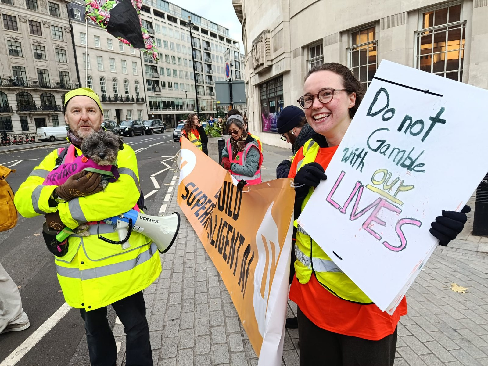
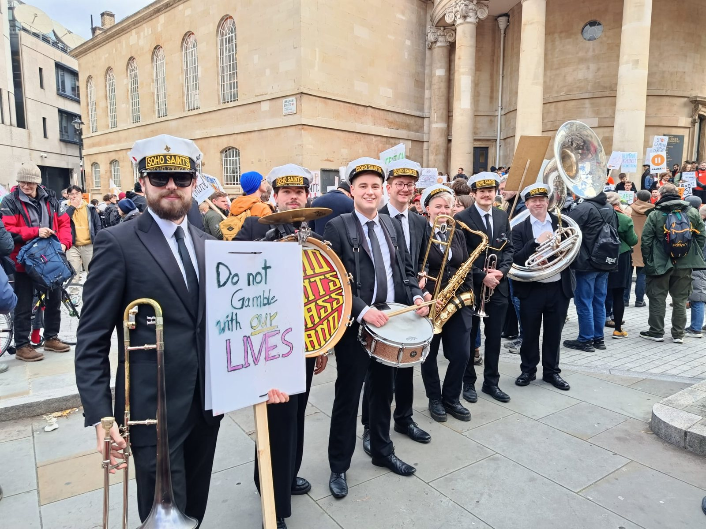

*Londýn, november 2026. Na transparente: „Nehazardujte s našimi životmi.“*

Väčšina ľudí, ktorých umelá inteligencia znepokojuje, o tom hovorí doma alebo na internete.
Politik to nevidí. Protest je spôsob, ako z obavy urobiť niečo, čo sa dá odfotiť, spočítať
a o čom sa dá napísať. V článku
[Ako chceme pauzu dosiahnuť](/clanky/ako-chceme-pauzu-dosiahnut/) píšeme, že medzinárodná
dohoda potrebuje verejnú podporu, ktorú je vidno. Toto je jeden zo spôsobov, ako ju ukázať.

## Fungujú protesty?

Dá sa to merať lepšie, než by sa zdalo.

- **Počasie ako pokus.** V apríli 2009 sa v Spojených štátoch konali stovky zhromaždení
  hnutia Tea Party. Kde v ten deň pršalo, prišlo menej ľudí. Ekonómovia to využili na
  porovnanie a zistili, že väčšie zhromaždenie znamenalo silnejšie miestne hnutie, viac hlasov
  vo voľbách o rok neskôr a zmenu v hlasovaní poslancov
  ([Madestam a kol., 2013](https://doi.org/10.1093/qje/qjt021)).
- **Na spôsobe záleží.** Počas boja za občianske práva v 60. rokoch posúvali pokojné
  protesty médiá aj verejnú mienku v prospech protestujúcich. Protesty, pri ktorých
  protestujúci siahli po násilí, ju posúvali opačne
  ([Wasow, 2020](https://doi.org/10.1017/S000305542000009X)).

Obe štúdie sú zo Spojených štátov a o iných témach. Nedokazujú, že protest za bezpečnú AI
niečo zmení. Hovoria, že pokojné a viditeľné zhromaždenie nie je len gesto.

Preto majú protesty PauseAI jedno pevné pravidlo: nenásilie. Účastníci sa hlásia ku
[kódexu](https://pauseai.info/protesters-code-of-conduct), ktorý žiada pokojné správanie,
rešpekt k okoloidúcim aj polícii a dodržiavanie zákonov.

## Ako protest PauseAI vyzerá

Zvyčajne je malý, pokojný a krátky: desiatky ľudí na chodníku pred sídlom firmy alebo úradu,
oranžové transparenty, pár prejavov do megafónu, letáky pre okoloidúcich. Prvý protest pred
londýnskym sídlom Google DeepMind v roku 2023 si dal za cieľ byť „informatívny, otvorený
a pokojne aj vtipný, nie konfrontačný“.

*Londýn, november 2026. Pochod sprevádzala dychová kapela, v pozadí účastníci s transparentmi.*

### Čo je na transparentoch

Heslá sú krátke a dajú sa prečítať z druhej strany ulice. Z protestov a materiálov hnutia:

- „Pause AI“ so symbolom pauzy
- „Stop building AGI“ (Prestaňte stavať AGI)
- „Don't let AI decide our future“ (Nenechajme AI rozhodovať o našej budúcnosti)
- „What if we can't pull the plug?“ (Čo ak sa to nebude dať vypnúť?)
- „Pause the race to the bottom“ (Zastavme preteky ku dnu)
- „Do not gamble with our lives“ (Nehazardujte s našimi životmi)
- „Humans against extinction“ (Ľudia proti vyhynutiu)

### Čo sa skanduje

Skanduje sa krátko a v rytme, zvyčajne po anglicky, lebo protesty bývajú medzinárodné:

- „We want AI treaty now!“ (Chceme zmluvu o AI hneď!)
- „It's not too late to regulate!“ (Ešte nie je neskoro regulovať!)

Jeden človek s megafónom heslo začne a ostatní sa pridajú. Slovenské verzie zatiaľ nemáme
ustálené. Ak nejakú vymyslíš, [napíš nám](mailto:info@pauseai.sk).

## Ako si vyrobiť transparent

Stačí kartón a hrubá fixka. [Návod hnutia](https://pauseai.info/organizing-a-protest) radí:

1. **Málo slov.** Tri až šesť slov. Ak sa heslo nedá prečítať za dve sekundy, je dlhé.
2. **Veľké písmená a hrubá čiara.** Tmavá farba na svetlom podklade, alebo čierna na oranžovej.
3. **Oranžová a symbol pauzy.** Na fotografii potom vidno, že ľudia patria k sebe.
4. **Bez nadávok.** Médiá fotku s nadávkou neuverejnia.
5. **Pevný podklad.** Kartón z väčšej škatule, okolo veľkosti A2. Proti dažďu pomôže
   priehľadná lepiaca páska cez celý nápis.
6. **Držadlo.** Latka alebo kartónová rúrka prilepená zozadu, aby si transparent udržal
   aj hodinu.

Kto nechce maľovať, vytlačí si hotové predlohy z
[nástroja na materiály](https://pauseai.info/tools/materials). Dobrý zvyk je stretnúť sa deň
vopred a vyrobiť transparenty spolu.

## Ak chceš protest zorganizovať na Slovensku

Na zhromaždenie netreba povolenie. Treba ho oznámiť
([zákon č. 84/1990 Zb. o zhromažďovacom práve](https://static.slov-lex.sk/static/SK/ZZ/1990/84/20240715.html)):

- **Komu:** obci alebo mestskej časti, kde sa zhromaždenie koná. Políciu informuje obec.
- **Kedy:** písomne tak, aby oznámenie dostala najmenej 5 dní a najviac 6 mesiacov vopred.
- **Kto:** občan starší ako 18 rokov, právnická osoba alebo skupina osôb.
- **Čo v ňom má byť:** účel, deň, miesto a čas, predpokladaný počet účastníkov, počet
  a označenie usporiadateľov, trasa, ak ide o pochod, a údaje zvolávateľa.
- **Kde to nejde:** do 50 metrov od sídla prezidenta, Národnej rady, vlády a Ústavného súdu.

Toto je stručný prehľad, nie právna rada. Pred podaním si prečítaj zákon a pozri sa, či má
tvoja obec vlastný formulár.

Okrem oznámenia treba ešte pár vecí:

- **Jedna požiadavka.** Okoloidúci aj novinár si majú odniesť jednu vetu.
- **Miesto, ktoré dáva zmysel.** Úrad, ktorý o veci rozhoduje, alebo námestie, kde chodia ľudia.
- **Usporiadatelia.** Pár ľudí vo vestách, ktorí vedia, čo robiť, keď sa niečo pokazí.
- **Fotky a krátke video.** Záber zblízka, ľudia s transparentmi, niekto hovorí. Tridsať
  sekúnd stačí.
- **Médiá.** Miestnym redakciám napíš deň až dva vopred a ponúkni rozhovor.

**Chceš protest zorganizovať alebo s ním pomôcť? [Ozvi sa nám](/#pridaj-sa)** alebo napíš na
[info@pauseai.sk](mailto:info@pauseai.sk). Pomôžeme s oznámením, materiálmi aj s tým, aby si
na to nebol sám.

## Doterajšie protesty PauseAI

Výber. Úplný zoznam vedie hnutie na stránke [pauseai.info/protests](https://pauseai.info/protests).

- **Máj 2023, Londýn.** Prvý protest pred sídlom Google DeepMind
  ([PauseAI](https://pauseai.info/2023-may-deepmind-london)).
- **1. novembra 2023, Bletchley Park.** Počas prvého medzinárodného samitu o bezpečnosti AI.
- **13. mája 2024, 13 miest.** Medzi nimi Londýn, Berlín, Paríž, Rím a San Francisco, pred
  samitom v Soule. V Londýne stálo pred ministerstvom okolo dvadsať ľudí
  ([TIME](https://time.com/6977680/ai-protests-international/)).
- **Február 2025, viac ako 15 miest.** Pred samitom v Paríži, medzi mestami bola aj Praha
  ([PauseAI](https://pauseai.info/2025-february)).
- **30. júna 2025, Londýn.** Pred sídlom Google DeepMind žiadalo asi 60 ľudí, aby firma
  dodržala sľuby o bezpečnostnom testovaní
  ([Business Insider](https://www.aol.com/protesters-accuse-google-breaking-promises-225401661.html)).
- **13. decembra 2025, Amsterdam.** Asi 25 ľudí žiadalo holandskú vládu a firmu ASML, aby
  svoje stroje dodávala len tým, ktorí sa zaviažu k moratóriu
  ([PauseAI](https://pauseai.info/amsterdam-protest-2025-december)).
- **28. februára 2026, Londýn.** Pochod od sídla OpenAI k sídlam Googlu a Mety, podľa
  organizátorov viac ako 300 ľudí ([PauseAI](https://pauseai.info/protest-london-feb-2026)).
- **31. augusta 2026, Praha.** Pochod od námestia Jana Palacha. Organizátori uvádzajú 50
  účastníkov, server Lupa.cz „nanajvýš niekoľko desiatok“
  ([PauseAI Česko](https://pauseai.cz/nase-cinnost),
  [Lupa.cz](https://www.lupa.cz/clanky/musime-omezit-nove-algoritmy-vyrobu-cipu-a-regulovat-vypocetni-vykon-v-cr-vznikly-neziskovky-bojujici-s-riziky-ai/)).
- **14. novembra 2026, Berlín.** Pochod za medzinárodnú zmluvu o AI, súčasť dňa protestov
  v približne dvadsiatich mestách ([Luma](https://luma.com/1k7hxuae)).
- **November 2026, Londýn.** Pochod March Against AI Extinction od kostola All Souls
  k Downing Street. Z neho sú fotografie v tomto článku.

Čísla sú malé a nezakrývame to. Rastú však: prvé protesty mali do dvadsať ľudí, posledné
londýnske stovky.

Na Slovensku sa protest PauseAI zatiaľ nekonal. Ak chceš byť pri prvom,
[pridaj sa](/#pridaj-sa).
